# Router test on Metro Manila routes

Task ticket: [#6 Test a router on Metro Manila routes](https://github.com/geadlydrim/CommuteNity-Web/issues/6), under the street-paths map ([#2](https://github.com/geadlydrim/CommuteNity-Web/issues/2)). Engines come from the shortlist in [routing-engines.md](https://github.com/geadlydrim/CommuteNity-Web/blob/research/routing-engines/docs/research/routing-engines.md) (branch `research/routing-engines`). This page records measurements. It makes no product decision.

- **[MEASURED]** is a number from this run (2026-11-04, one machine). **[INFERENCE]** is my reading, not checked on the ground.
- Terms follow `GLOSSARY.md`: pin, leg, via, street path, straight line.
- Engines tested: **Valhalla 3.9.1** (self-hosted: `auto` and `pedestrian` on one tile set). **OSRM was not run**: `free -m` showed 6.3 to 8.6 GiB available whenever I checked, below the 9 GiB the ticket requires before starting it.

## Summary

- **Car corridors (12 real routes, `auto`, no vias).** 2 are a `useful default`, 1 is `close`, 9 are `off`. The two that work are obvious main-road trips (Cubao to Divisoria via Aurora; Commonwealth to SM Fairview). The sample is not random: I picked it to cover the corridors named in the ticket.
- **Vias.** Simulating an author who drags the path onto the reference, all 12 reached 95% overlap on both measures within the 10-via limit. Needed: 0, 0, 1, 1, 1, 2, 2, 2, 2, 3, 6 and 9 vias (median 2).
- **Why it diverges.** The car path is the quickest route between the two ends. Jeepney and bus routes are not. On two routes the car path took toll expressways (7.8 and 8.0 km of motorway), and one reference follows the EDSA Busway (`highway=busway`, `access=no`). No reference runs against a one-way. See [Observations](#observations).
- **Walking.** `pedestrian` returned a path for all 4 corridors, 1.06 to 1.41 times the straight-line distance, and 2 of them use a footway bridge or stairs. Most of the length is on `road` edges with few mapped sidewalks. Car routing between the same points was 1.75 to 13.7 times the straight line.
- **Existing posts.** All 10 pin pairs routed without error; routed length is 1.0 to 2.0 times the straight line.
- **Latency.** Valhalla `auto`: p50 16 ms (0 vias), 24 ms (5), 31 ms (10); p95 23, 40, 58 ms. `pedestrian`: p50 14 ms.

## Setup

**Machine.** AMD Ryzen 5 6600H (12 threads), 14 GiB RAM, NVMe, Fedora 43 (kernel 7.1.13), rootless Podman 5.8.4. Another agent and a browser were using the machine, so timings include contention.

**Input.** Geofabrik `philippines-261102.osm.pbf` (Geofabrik's `-latest` redirects to this dated file), downloaded 2026-11-04, 612,601,301 bytes, md5 `b0aa75e61365514f1184f2f48b15f24f`, which matches Geofabrik's `.md5`.

**Image.** `ghcr.io/valhalla/valhalla:3.9.1` (662 MB; the same version the research measured). It reports `3.9.1`; created 2026-10-06; local image id `e9b52be8c5d3`.

**Build.** `valhalla_build_tiles`, no admins, timezones or elevation, under `podman run --memory 4g --memory-swap 4g`: 4 min 4 s wall (243 s inside Valhalla), 574 MiB of tiles [MEASURED]. It finished under the 4 GiB cap.

**Serve.** `valhalla_service` with 2 threads under `--memory 2g`, on `127.0.0.1:8002`.

**Python.** venv with pyproj 3.8.0, shapely 2.2.0, Pillow 13.0.0, requests 2.34.2, numpy 2.5.4 (Python 3.14).

Everything is scripted in `scripts/router-test/` and can be run again (commands under [Where the test instance runs](#where-the-test-instance-runs)).

## Method

**Reference routes (ground truth).** Two Overpass queries (`overpass-api.de`, User-Agent naming this test, responses cached) over the box 14.35–14.80 N, 120.90–121.20 E, each with `out geom meta`:

1. jeepneys: `type=route` + `route=bus` + `bus=share_taxi` (314 relations);
2. city buses: `route=bus` + `network~"LTFRB National Capital Region"` (440 relations, 144 of them not already in the first set, since the network tag is also on jeepneys).

Each relation's way members were stitched, in member order, into one line. Ways were reversed where needed, and `platform` and `stop` members were skipped. A way had to share an end node with the line so far (exact coordinate match, no gap allowed). **Rejected: 46 of 458 relations** (28 of 314 jeepney relations and 18 of 144 bus relations) because the ways did not join (45 with a gap later in the member list, 1 between the first two ways). The other 412 stitched. I picked 12 of those: 10 jeepney and 2 bus routes. They cover the España, Quezon Avenue, Commonwealth, Taft/Mabini and EDSA corridors from the ticket plus others in the north (Malanday), south (Alabang to Baclaran) and Katipunan. The sample is purposive, not random.

**Staleness.** The relations' last edits run from 2026-07-30 to 2026-10-26, after the post-2020 route rationalization, but OSM can still lag the street (see [Caveats](#caveats)). Each relation's id, name, mode, length and last edit are in the table below.

**Car comparison.** For each reference, route Valhalla `auto` from the stitched line's first point to its last, no vias. Metrics in UTM 51N (EPSG:32651, pyproj) with shapely, tolerance **25 m**:

- `overlap_ref`: the share of the reference's length within 25 m of the router path.
- `overlap_path`: the share of the router path's length within 25 m of the reference.
- length ratio: router length divided by reference length.

Verdict: `useful default` if both overlaps are at least 90%; `close` if both are at least 75%; otherwise `off`. The 25 m figure is meant to absorb carriageway offsets and snapping while staying narrower than most parallel streets [INFERENCE: a choice, not a standard].

**Via simulation.** Models an author in Reshape mode with at most 10 vias. Repeat: find the longest stretch of the reference that is not within 25 m of the current path, add a Valhalla `through` via at the stretch's midpoint (vias kept in reference order), re-route; stop when both overlaps are at least 95% or 10 vias are used. The vias sit exactly on the reference, so this is closer to a careful author than to a hurried one.

**Walking.** Valhalla `pedestrian` between anchor points found through Overpass (OSM element ids in `results.json` under `walk_anchors`). `trace_attributes` (`shape_match: walk_or_snap`) gives each edge's `use`, `bridge`, `tunnel` and `sidewalk`. There is no ground truth, so each path is described. Valhalla `auto` between the same points is shown for contrast.

**Existing posts.** Read-only query of `posts.map_data` and `comments.map_data`. Each consecutive pin pair of a post and each leg of a guide was routed (`walk` legs with `pedestrian`, everything else with `auto`). Only pins and labels were used.

**Latency.** 50 sequential requests per series from a local client, 3 uncounted warm-up requests per series. Each request is an up-to-8 km stretch of one of the 12 reference routes (they cycle). Vias are evenly spaced along the stretch. The times include JSON decoding and polyline decoding in the client.

## Car corridors

| Reference (OSM relation) | Mode | Ref. length | Last edit | Engine | Router km | Overlap ref | Overlap path | Length ratio | Verdict | Vias to reach 95% |
|---|---|---|---|---|---|---|---|---|---|---|
| [14885756](https://www.openstreetmap.org/relation/14885756): Arroceros–Project 7 via España (ref 310) | jeepney | 10.1 km | 2026-09-06 | Valhalla auto | 11.5 | 72% | 64% | 1.14 | **off** | 1 |
| [14885770](https://www.openstreetmap.org/relation/14885770): Cubao–Divisoria via Santa Mesa, Aurora (ref 372) | jeepney | 10.6 km | 2026-09-12 | Valhalla auto | 10.6 | 99% | 100% | 1.00 | **useful default** | 0 |
| [9856704](https://www.openstreetmap.org/relation/9856704): Route 17: Ayala–Fairview via Quezon Avenue (ref 17) | bus | 16.7 km | 2026-09-01 | Valhalla auto | 16.0 | 77% | 80% | 0.96 | **close** | 3 |
| [14878113](https://www.openstreetmap.org/relation/14878113): Bagong Silang–QMC via Commonwealth (ref 102) | jeepney | 20.3 km | 2026-08-06 | Valhalla auto | 17.1 | 30% | 36% | 0.84 | **off** | 1 |
| [8202646](https://www.openstreetmap.org/relation/8202646): Commonwealth–SM Fairview via Regalado (ref 111) | jeepney | 7.2 km | 2026-08-06 | Valhalla auto | 7.2 | 100% | 100% | 1.00 | **useful default** | 0 |
| [19701253](https://www.openstreetmap.org/relation/19701253): Baclaran–Dapitan via Taft (ref 325) | jeepney | 16.7 km | 2026-09-12 | Valhalla auto | 16.3 | 35% | 36% | 0.97 | **off** | 6 |
| [14885760](https://www.openstreetmap.org/relation/14885760): Libertad–Monumento via Taft (ref 3150) | jeepney | 14.3 km | 2026-09-12 | Valhalla auto | 14.4 | 57% | 57% | 1.00 | **off** | 2 |
| [21293817](https://www.openstreetmap.org/relation/21293817): Baclaran–Divisoria via Mabini (ref 327) | jeepney | 15.1 km | 2026-09-12 | Valhalla auto | 12.3 | 23% | 29% | 0.81 | **off** | 9 |
| [9453755](https://www.openstreetmap.org/relation/9453755): Route 1: EDSA Carousel (ref 1) | bus | 27.0 km | 2026-07-30 | Valhalla auto | 19.8 | 8% | 14% | 0.73 | **off** | 2 |
| [15093996](https://www.openstreetmap.org/relation/15093996): Malanday–Divisoria via M.H. del Pilar (ref 3162) | jeepney | 13.9 km | 2026-09-12 | Valhalla auto | 17.6 | 25% | 20% | 1.25 | **off** | 2 |
| [15094000](https://www.openstreetmap.org/relation/15094000): Alabang–Baclaran via Imelda, SSH (ref T430) | jeepney | 13.3 km | 2026-09-06 | Valhalla auto | 15.6 | 8% | 13% | 1.17 | **off** | 2 |
| [4515957](https://www.openstreetmap.org/relation/4515957): Katipunan/LRT–North EDSA (ref 269) | jeepney | 11.1 km | 2026-10-26 | Valhalla auto | 8.9 | 23% | 33% | 0.81 | **off** | 1 |

"Overlap ref / path" are the two shares at the default (no vias). Valhalla was the only engine run.

**España Boulevard** (relation 14885756). Left: reference (grey) and the Valhalla `auto` path (blue). Right: the reshaped path (magenta) with the numbered vias.

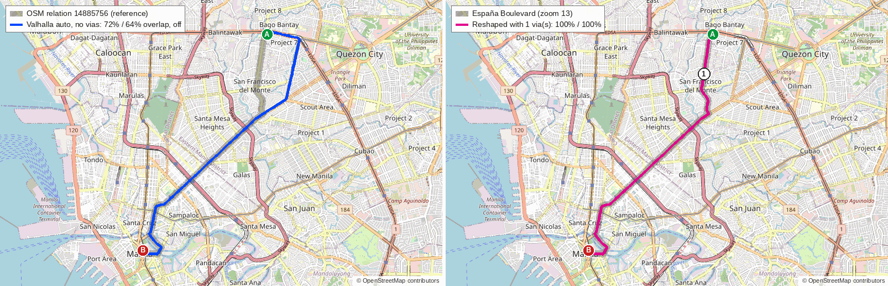

**Cubao to Divisoria via Aurora** (relation 14885770). Left: reference (grey) and the Valhalla `auto` path (blue). Right: the reshaped path (magenta) with the numbered vias.

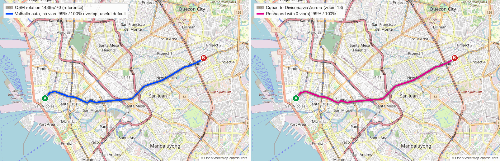

**Quezon Avenue to Fairview** (relation 9856704). Left: reference (grey) and the Valhalla `auto` path (blue). Right: the reshaped path (magenta) with the numbered vias.

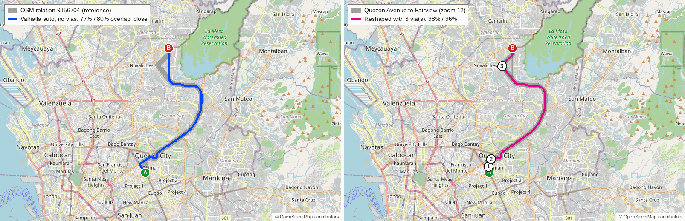

**Commonwealth Avenue** (relation 14878113). Left: reference (grey) and the Valhalla `auto` path (blue). Right: the reshaped path (magenta) with the numbered vias.

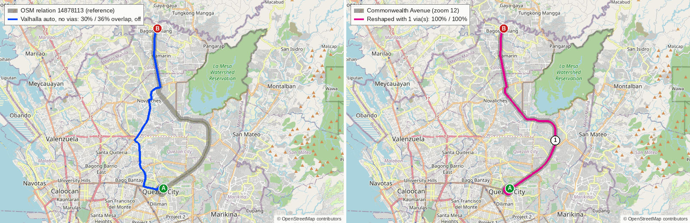

**Commonwealth to SM Fairview** (relation 8202646). Left: reference (grey) and the Valhalla `auto` path (blue). Right: the reshaped path (magenta) with the numbered vias.

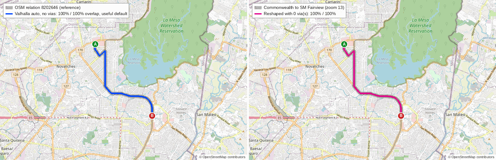

**Taft Avenue** (relation 19701253). Left: reference (grey) and the Valhalla `auto` path (blue). Right: the reshaped path (magenta) with the numbered vias.

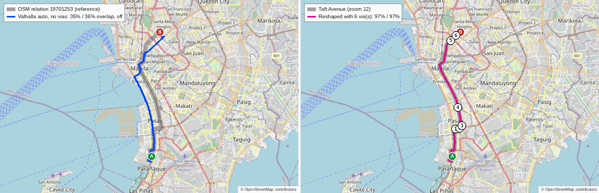

**Taft Avenue to Monumento** (relation 14885760). Left: reference (grey) and the Valhalla `auto` path (blue). Right: the reshaped path (magenta) with the numbered vias.

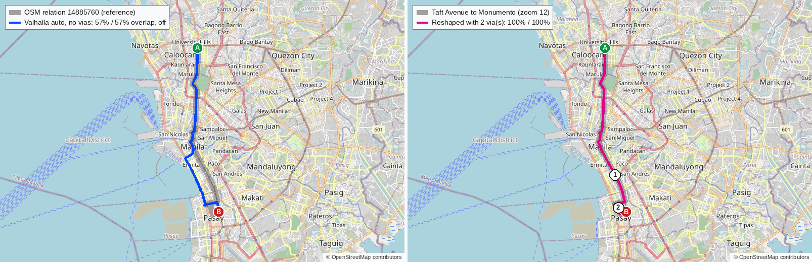

**Mabini / Taft side streets** (relation 21293817). Left: reference (grey) and the Valhalla `auto` path (blue). Right: the reshaped path (magenta) with the numbered vias.

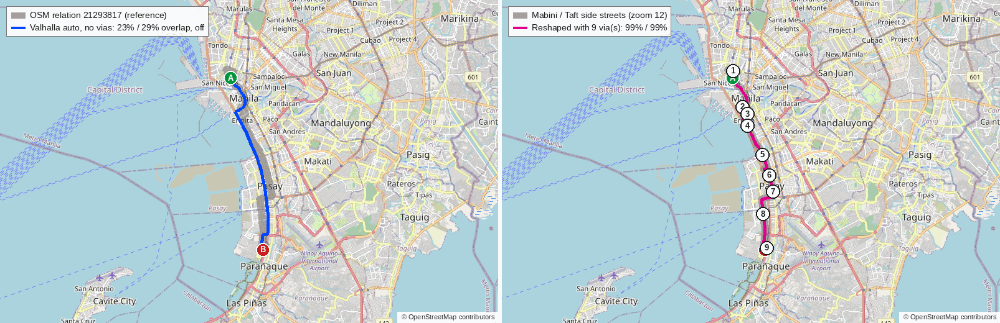

**EDSA Carousel** (relation 9453755). Left: reference (grey) and the Valhalla `auto` path (blue). Right: the reshaped path (magenta) with the numbered vias.

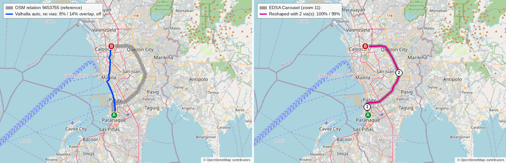

**M.H. del Pilar to Divisoria** (relation 15093996). Left: reference (grey) and the Valhalla `auto` path (blue). Right: the reshaped path (magenta) with the numbered vias.

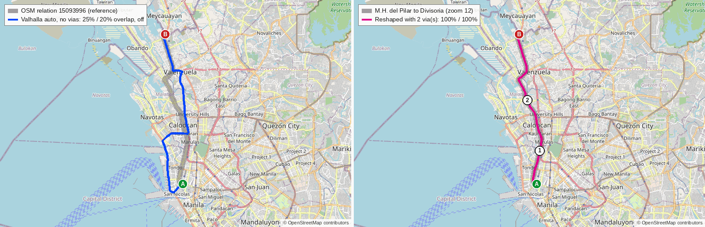

**Imelda / SSH south** (relation 15094000). Left: reference (grey) and the Valhalla `auto` path (blue). Right: the reshaped path (magenta) with the numbered vias.

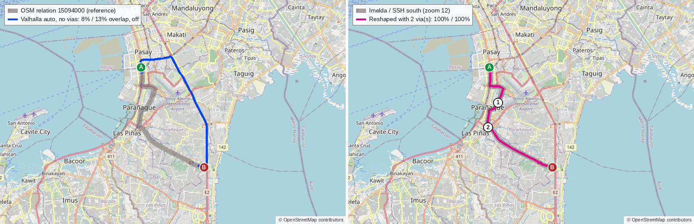

**Katipunan to North EDSA** (relation 4515957). Left: reference (grey) and the Valhalla `auto` path (blue). Right: the reshaped path (magenta) with the numbered vias.

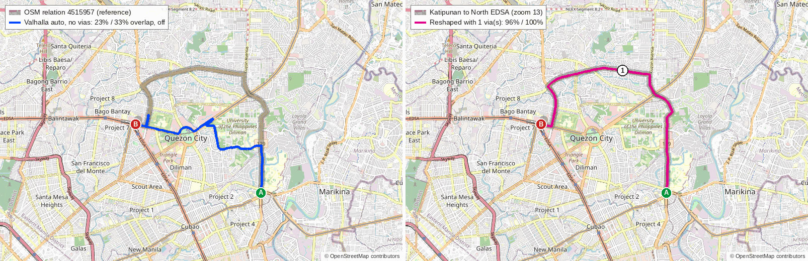


### Via simulation

Overlap (ref/path) after 0, 1, 2, … vias. All 12 reached at least 95% on both measures within 10 vias.

| Corridor | Overlap ref / path after 0, 1, 2, … vias | Final | Via coordinates (lng, lat) |
|---|---|---|---|
| España Boulevard | 72%/64%, 100%/100% | 1 via(s), 100%/100% | 121.0171, 14.6447 |
| Cubao to Divisoria via Aurora | 99%/100% | 0 via(s), 99%/100% | none |
| Quezon Avenue to Fairview | 77%/80%, 94%/93%, 90%/90%, 98%/96% | 3 via(s), 98%/96% | 121.0419, 14.6420; 121.0439, 14.6479; 121.0528, 14.7207 |
| Commonwealth Avenue | 30%/36%, 100%/100% | 1 via(s), 100%/100% | 121.0874, 14.6904 |
| Commonwealth to SM Fairview | 100%/100% | 0 via(s), 100%/100% | none |
| Taft Avenue | 35%/36%, 61%/61%, 76%/72%, 84%/77%, 86%/79%, 94%/93%, 97%/97% | 6 via(s), 97%/97% | 120.9948, 14.5361; 120.9986, 14.5370; 121.0006, 14.5392; 120.9969, 14.5555; 120.9901, 14.6153; 120.9952, 14.6199 |
| Taft Avenue to Monumento | 57%/57%, 87%/92%, 100%/100% | 2 via(s), 100%/100% | 120.9906, 14.5719; 120.9928, 14.5503 |
| Mabini / Taft side streets | 23%/29%, 28%/33%, 41%/43%, 53%/55%, 61%/63%, 70%/68%, 86%/91%, 92%/92%, 92%/93%, 99%/99% | 9 via(s), 99%/99% | 120.9732, 14.6051; 120.9783, 14.5858; 120.9811, 14.5820; 120.9811, 14.5757; 120.9894, 14.5603; 120.9930, 14.5493; 120.9952, 14.5404; 120.9898, 14.5285; 120.9917, 14.5103 |
| EDSA Carousel | 8%/14%, 91%/90%, 100%/99% | 2 via(s), 100%/99% | 120.9900, 14.5284; 121.0595, 14.6010 |
| M.H. del Pilar to Divisoria | 25%/20%, 58%/45%, 100%/100% | 2 via(s), 100%/100% | 120.9745, 14.6318; 120.9648, 14.6702 |
| Imelda / SSH south | 8%/13%, 63%/59%, 100%/100% | 2 via(s), 100%/100% | 120.9998, 14.5044; 120.9918, 14.4853 |
| Katipunan to North EDSA | 23%/33%, 96%/100% | 1 via(s), 96%/100% | 121.0594, 14.6731 |

Progress is not always monotonic: on Quezon Avenue to Fairview, one via gave 94%/93% and two vias gave 90%/90% before the third raised it to 98%/97%. Mabini / Taft needed 9 vias, with a dip between the 7th and 8th. [INFERENCE: a `through` point snapped to the wrong carriageway or side street adds a spur or a detour.]

### Extra (not asked for): the same query with tolls and highways discouraged

Two default paths ran on expressways (E5 and E2, 7.8 and 8.0 km of motorway), which jeepneys cannot use. I re-ran each default query with Valhalla's `costing_options.auto` set to `use_tolls: 0` and `use_highways: 0` to see how much of the gap that explains. No vias; same metrics.

| Corridor | Default: ref / path overlap, verdict | Toll + highways discouraged: ref / path overlap, verdict | Motorway km on default path (toll km) |
|---|---|---|---|
| España Boulevard | 72% / 64%, off | 100% / 100%, useful default | 0.0 (0.0) |
| Cubao to Divisoria via Aurora | 99% / 100%, useful default | 99% / 100%, useful default | 0.0 (0.0) |
| Quezon Avenue to Fairview | 77% / 80%, close | 77% / 80%, close | 0.0 (0.0) |
| Commonwealth Avenue | 30% / 36%, off | 30% / 36%, off | 0.0 (0.0) |
| Commonwealth to SM Fairview | 100% / 100%, useful default | 100% / 100%, useful default | 0.0 (0.0) |
| Taft Avenue | 35% / 36%, off | 50% / 50%, off | 0.0 (0.0) |
| Taft Avenue to Monumento | 57% / 57%, off | 87% / 92%, close | 0.0 (0.0) |
| Mabini / Taft side streets | 23% / 29%, off | 34% / 41%, off | 0.0 (0.0) |
| EDSA Carousel | 8% / 14%, off | 16% / 24%, off | 0.0 (0.2) |
| M.H. del Pilar to Divisoria | 25% / 20%, off | 72% / 69%, off | 7.8 (8.3) |
| Imelda / SSH south | 8% / 13%, off | 90% / 86%, close | 8.0 (9.3) |
| Katipunan to North EDSA | 23% / 33%, off | 23% / 33%, off | 0.0 (0.0) |

This is a profile setting, not a via, and I did not look at what it does on the rest of the network.

## Walking corridors

| Corridor | Straight | Pedestrian | Time | Ratio | Edge `use` share (by length) | Bridge / tunnel / steps / elevator | Auto (same points) |
|---|---|---|---|---|---|---|---|
| Cubao MRT-3 to Gateway Mall | 334 m | 451 m | 5.4 min | 1.35 | road 53%, service_road 33%, footway 7%, steps 6%, pedestrian_crossing 0% | bridge 33 m (33 m footway); tunnel 179 m; steps 27 m; elevator 0 m; marked crossings 1 | 1799 m, 3.2 min (5.4× straight; 12% of the walk is within 25 m of it) |
| Quiapo Church to Carriedo LRT-1 | 264 m | 279 m | 3.3 min | 1.06 | road 91%, footway 9% | bridge 0 m (0 m footway); tunnel 0 m; steps 0 m; elevator 0 m; marked crossings 0 | 3616 m, 4.2 min (13.7× straight; 15% of the walk is within 25 m of it) |
| Ayala MRT-3 to Glorietta | 358 m | 505 m | 6.0 min | 1.41 | road 83%, footway 13%, steps 3%, driveway 1% | bridge 2 m (2 m footway); tunnel 50 m; steps 16 m; elevator 0 m; marked crossings 0 | 3111 m, 3.5 min (8.7× straight; 42% of the walk is within 25 m of it) |
| Recto LRT-2 to 168 Mall | 1258 m | 1565 m | 18.5 min | 1.24 | road 90%, service_road 10% | bridge 42 m (0 m footway); tunnel 0 m; steps 0 m; elevator 0 m; marked crossings 0 | 2205 m, 3.9 min (1.8× straight; 50% of the walk is within 25 m of it) |

Anchors are building or station coordinates, not entrances: the router snaps each to the nearest walkable edge, so ends may sit on a street beside the building. No ground truth exists, so what follows describes each path.

- **Cubao MRT-3 to Gateway Mall: 451 m, 5.4 min, 1.35 times the straight line.** It starts with 33 m of footway tagged `bridge` and 27 m of steps (the station's exit walkway and stairs [INFERENCE]), crosses one marked crossing, then follows Central Avenue's service road (149 m), then General Araneta Avenue and General Roxas Avenue, where 179 m of the road edges are tagged `tunnel` (underpasses). No sidewalk is mapped on those road edges. [INFERENCE: the walk through the underpasses is a data gap, since walkers do not usually share a vehicle tunnel; I did not check the ground.] Car routing takes 1.8 km, and only 12% of the walk lies within 25 m of it.
- **Quiapo Church to Carriedo LRT-1: 279 m, 3.3 min, 1.06 times the straight line.** 91% `road` (Carriedo Street, 219 m with a mapped sidewalk) and 26 m of footway. No bridge, tunnel or steps. Car routing takes 3.6 km. [INFERENCE: the direct streets are closed to cars in the data, by one-way or pedestrian-only tagging; I did not check which.]
- **Ayala MRT-3 to Glorietta: 505 m, 6.0 min, 1.41 times the straight line.** Starts on 50 m of footway, 2 m of bridge and 16 m of steps (the MRT-3 station approach [INFERENCE]), then Station Road (50 m of it tagged `tunnel`) and Palm Drive. The Glorietta anchor is a mall building, so the path ends at the nearest street; indoor mall paths do not appear. Car routing takes 3.1 km.
- **Recto LRT-2 to 168 Mall: 1,565 m, 18.5 min, 1.24 times the straight line.** Almost entirely C. M. Recto Avenue (`road`, 291 m of it with a mapped sidewalk, 42 m on two bridge-tagged edges) and a 161 m service road at the end. No footbridge, tunnel or elevator. Car routing takes 2.2 km, and 50% of the walk is within 25 m of it.

No elevator or escalator edge appears in any of the four paths.

**Cubao MRT-3 to Gateway Mall** (MRT-3 Cubao station to Gateway Mall 1): pedestrian (magenta), auto (blue dashed).

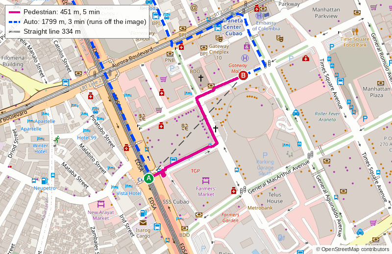

**Quiapo Church to Carriedo LRT-1** (Quiapo Church to Carriedo LRT-1 station): pedestrian (magenta), auto (blue dashed).

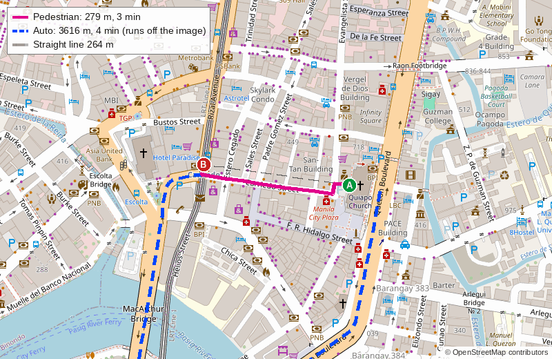

**Ayala MRT-3 to Glorietta** (Ayala MRT-3 station to Glorietta mall): pedestrian (magenta), auto (blue dashed).

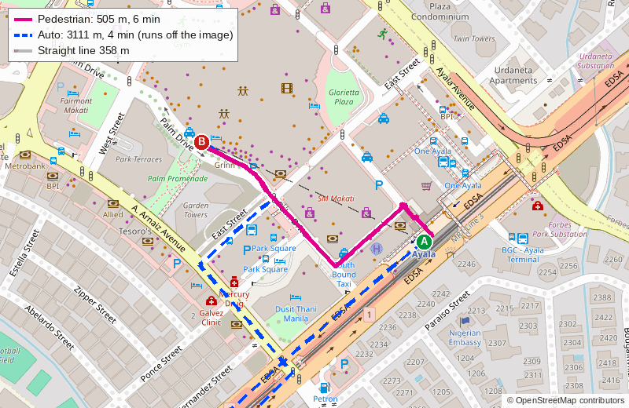

**Recto LRT-2 to 168 Mall** (Recto LRT-2 station to 168 Shopping Mall): pedestrian (magenta), auto (blue dashed).

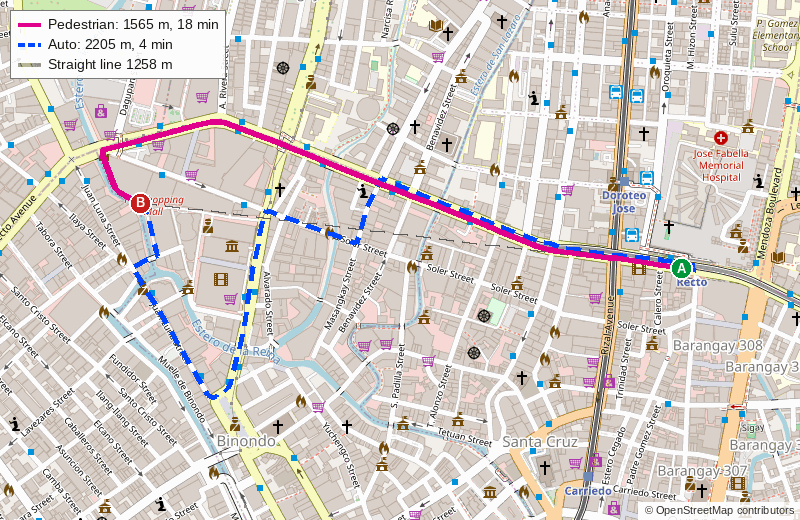


## Existing posts' pins

| Source | Mode | From | To | Straight km | Routed km | Ratio | Error |
|---|---|---|---|---|---|---|---|
| post | - | C. M. Recto Avenue | Legarda Street | 1.82 | 3.19 | 1.76 | none |
| post | - | SM Valenzuela | San Pablo City Central Terminal | 77.13 | 95.42 | 1.24 | none |
| post | - | Karuhatan | Ramen Nagi | 4.06 | 5.01 | 1.24 | none |
| post | - | MacArthur Highway | Bonifacio Global City | 18.25 | 27.22 | 1.49 | none |
| guide leg | bus | SM Valenzuela | San Pablo City Central Terminal | 77.15 | 95.45 | 1.24 | none |
| guide leg | jeepney | SM City San Pablo | Sampaloc Lake | 3.12 | 4.69 | 1.5 | none |
| guide leg | jeepney | Jeepney Market | People Power Monument | 13.64 | 17.85 | 1.31 | none |
| guide leg | bus | Yamaha Monumento | Guadalupe | 11.75 | 23.32 | 1.99 | none |
| guide leg | jeepney | T. Mapua Street | Magsaysay Boulevard | 1.84 | 2.77 | 1.51 | none |
| guide leg | bus | Legarda Street | NLEX-SLEX Connector Road | 0.96 | 0.96 | 1.0 | none |

The second post and the first guide leg share the same pins (SM Valenzuela to San Pablo City Central Terminal). Every pair routed; none returned an error. The ratio is 1.0 to 2.0 times the straight line: 1.99 for Yamaha Monumento to Guadalupe (the pins are 11.8 km apart and the path is 23.3 km) and 1.76 for C. M. Recto Avenue to Legarda Street (1.8 km apart, 3.2 km routed) are the two largest. [INFERENCE: one-way systems in Manila's center.] No ground truth exists for these.

## Latency

| Series | Requests | Failed | p50 ms | p95 ms | max ms |
|---|---|---|---|---|---|
| valhalla auto, 0 vias | 50 | 0 | 16.2 | 23.3 | 35.1 |
| valhalla auto, 5 vias | 50 | 0 | 24.2 | 40.1 | 51.7 |
| valhalla auto, 10 vias | 50 | 0 | 30.8 | 58.0 | 68.6 |
| valhalla pedestrian, 0 vias | 50 | 0 | 14.1 | 19.2 | 19.6 |

Sequential requests from the same machine, 3 uncounted warm-up requests per series; includes client JSON and polyline decoding. Each extra via adds about 1.5 ms at p50 on this machine. No request failed, including the 12-location (10-via) requests, which are under Valhalla's default `auto` limit of 20 locations.

## Observations

Where and why the car path diverges, with the evidence for each.

1. **Quickest path, not the route's path.** Of the 9 `off` corridors, the Valhalla path is between 0.73 and 1.26 times the reference's length, so it is not simply a detour. It is the quickest car route between the two ends, and the jeepney or bus line follows a different arterial. On the Taft routes the car path picks a different spine from the reference: its main roads are route 120, España Boulevard and Quezon Boulevard (table at the end of this section), while the reference stays on Taft Avenue, Cuneta Avenue and Roxas Boulevard's service road. Across the off-path stretches (the longest four per corridor, 100 m or more) the references list 710 way entries; 656 of them are not busway, and 551 are `primary` or `secondary` roads that a car can use.
2. **Toll expressways.** The Malanday to Divisoria and Alabang to Baclaran (Imelda / SSH) routes were the only ones where Valhalla `auto` used motorway: 7.8 km and 8.0 km of motorway (8.3 km and 9.3 km toll). Jeepneys cannot use those. Discouraging tolls and highways made Alabang to Baclaran `close` (90%/86%), España `useful default`, and Taft to Monumento `close` (see the table above).
3. **Busway.** On the EDSA Carousel's off-path stretches, 54 of the 97 way entries are `highway=busway` with `access=no` (EDSA Busway); the rest are ordinary EDSA and cross-street ways. A car router cannot use the busway lanes. The path went down the west side of the city instead (8% / 14% overlap, ratio 0.73). Two vias on EDSA brought it to 100% / 99%, since the car lanes of EDSA run within 25 m of the busway.
4. **One-ways did not cause the divergence on these references.** I checked every reference way's `oneway` tag against the direction the stitched route travels: 0 m ran against a `oneway=yes` way on any of the 12 (between 13% and 100% of each route's length is on one-way ways). One-ways do lengthen car paths between pins (the posts table, Quiapo to Carriedo).
5. **Jeepney-only streets, U-turn slots, service roads.** I found no way tagged jeepney-only or `psv`-only among the off-path stretches. The only access restrictions were the busway ways (`access=no`) and one `service` way (`access=no`, `bus=designated`); six entries carried `bus=designated` or `bus=yes`. I did not measure U-turn slots or service roads. [INFERENCE: if they matter, they show up inside the 1–2 via fixes, not as large stretches.]
6. **Where the default works.** Cubao to Divisoria via Aurora (99% / 100%) and Commonwealth to SM Fairview (100% / 100%) follow the only fast road between their ends (Aurora Boulevard, C. M. Recto and Magsaysay; Commonwealth and Regalado).
7. **What fixes the rest.** Most corridors had one dominant detour, so 1 or 2 vias were enough (Bagong Silang to QMC via Commonwealth, España, Katipunan: 1; Taft to Monumento, EDSA Carousel, M.H. del Pilar, Imelda: 2; Quezon Avenue to Fairview: 3). Taft (6) and Mabini (9) needed more: [INFERENCE: they run along streets parallel to faster roads, so each via fixes only a few kilometers].

Main roads on each default path (km), for reference:

| Corridor | Main roads on the default Valhalla path (km) |
|---|---|
| España Boulevard | Quezon Avenue 3.3, West Avenue 2.1, España Boulevard 2.0, 1 1.1, Quezon Boulevard 1.0 |
| Cubao to Divisoria via Aurora | Aurora Boulevard 4.5, C. M. Recto Avenue 2.8, Magsaysay Boulevard 1.9, Legarda Street 0.7, Legarda-Magsaysay Flyover 0.5 |
| Quezon Avenue to Fairview | Commonwealth Avenue 10.4, Regalado Highway 2.7, Quezon Avenue 1.2, Elliptical Road 0.8, 1 0.5 |
| Commonwealth Avenue | Quirino Highway 5.6, Zabarte Road 4.9, Mindanao Avenue 4.2, North Avenue 1.3, Elliptical Road 0.6 |
| Commonwealth to SM Fairview | Commonwealth Avenue 3.9, Regalado Highway 2.1, Belfast Avenue 0.8, Mindanao Avenue 0.4, (unnamed) 0.0 |
| Taft Avenue | 120 5.8, España Boulevard 2.0, 61 1.9, Quezon Boulevard 1.7, Padre Burgos Avenue 1.2 |
| Taft Avenue to Monumento | Rizal Avenue 3.7, 120 3.1, Rizal Avenue Extension 2.6, Padre Burgos Avenue 1.4, Senator Gil J. Puyat Avenue 0.9 |
| Mabini / Taft side streets | 120 5.8, Padre Burgos Avenue 1.9, 61 1.8, President Diosdado Macapagal Boulevard 0.7, Juan Luna Street 0.6 |
| EDSA Carousel | 120 5.8, Rizal Avenue 3.8, Rizal Avenue Extension 2.8, 61 1.9, Padre Burgos Avenue 1.2 |
| M.H. del Pilar to Divisoria | E5 6.4, 1 4.1, 120 3.8, (unnamed) 1.9, C. M. Recto Avenue 1.1 |
| Imelda / SSH south | E2 8.9, 1 2.6, 61 1.6, (unnamed) 1.4, Dr. A. Santos Avenue 0.8 |
| Katipunan to North EDSA | Carlos P. Garcia Avenue 2.5, Katipunan Avenue 1.7, North Avenue 1.7, Commonwealth Avenue 1.1, Mindanao Avenue 0.9 |

## Caveats

- **OSM relations may be stale or wrong.** Route relations are volunteer-maintained. A mismatch between the router and the reference could be the router's or the relation's. I did not verify any route on the ground. The latest edits on the 12 are July to October 2026.
- **The 25 m threshold is a choice.** A tighter tolerance lowers the overlap on dual carriageways; a wider one would count a parallel street as a match.
- **The sample is 12 routes picked from 412 stitched relations**, chosen to cover the corridors the ticket names. The verdict counts do not describe the whole network.
- **The via simulation is an upper bound on convenience.** The vias are placed exactly on the reference, at the longest uncovered stretch. A real author has no reference line to follow.
- **Rejected relations.** 46 of 458 relations were dropped because their ways did not join into one line. That favors tidy relations.
- **Stitching uses exact node coordinates.** A relation with a tiny gap counts as broken.
- **One machine, shared.** Another process was running. Latency is end-to-end from a client on the same host, so network time is not included.
- **Anchors are centers of buildings and stations**, not entrances, so walking paths end at the nearest street.
- **No OSRM comparison** (not enough free memory).
- **Not tested:** other `auto` options beyond the tolls/highways row, `pedestrian` options (walking speed, sidewalk preference), vias on walking legs, and rail legs.

## Where the test instance runs

All persistent data lives outside the repo, in `~/.cache/commutenity/router/`:

| Path | What | Size |
|---|---|---|
| `pbf/philippines-261102.osm.pbf` | Geofabrik extract | 585 MiB |
| `valhalla/tiles/`, `valhalla/valhalla.json` | Valhalla tile set and its config | 574 MiB |
| `venv/` | Python venv for the harness | 151 MiB |
| `tiles/` | cached OSM map tiles for the images (152 tiles) | 4.6 MiB |
| `http-cache/` | cached Overpass / Nominatim responses | 24 MiB |
| `db/`, `run/`, `logs/` | exported pins, per-run geometry, build log | under 1 MiB |

Total about 1.4 GiB.

- **Reach it:** `http://127.0.0.1:8002` (loopback only). For example `curl -s localhost:8002/status` or `POST /route` with `{"locations":[{"lat":14.6206,"lon":121.0532,"type":"break"},{"lat":14.5988,"lon":120.9838,"type":"break"}],"costing":"auto"}`. Vias are `"type":"through"`. Switch `costing` to `pedestrian` for walking.
- **Start / stop:** `scripts/router-test/serve-valhalla.sh start` and `scripts/router-test/serve-valhalla.sh stop` (container `cn-valhalla`, image `ghcr.io/valhalla/valhalla:3.9.1`, `--memory 2g`, 2 service threads).
- **Memory in use:** about 0.70 GiB resident for `valhalla_service` after the full test run (the tiles are memory-mapped, so this grows with the area queried; the research measured 0.09 GiB after a few queries). Build peak was kept under 4 GiB.
- **Status at the end of this task:** stopped. Data stays on disk.
- **Rebuild** (new extract or new Valhalla): set `PBF_NAME`, `PBF_URL` (and `VALHALLA_IMAGE`) in `scripts/router-test/env.sh`, then `download.sh`, `build-valhalla.sh`, `serve-valhalla.sh start`. The build takes about 4 minutes and needs about 4 GiB.
- **Delete everything:** `scripts/router-test/serve-valhalla.sh stop; rm -rf ~/.cache/commutenity/router; podman rmi ghcr.io/valhalla/valhalla:3.9.1`.
- **OSRM:** `scripts/router-test/osrm.sh build|start|stop` is written but was never run (it refuses to build below 9 GiB available).

### Run the test again

```bash
. scripts/router-test/env.sh
scripts/router-test/setup-venv.sh
scripts/router-test/download.sh            # PBF + md5 check
scripts/router-test/build-valhalla.sh      # ~4 min, --memory 4g
scripts/router-test/serve-valhalla.sh start
scripts/router-test/export-posts.sh        # read-only pins from the database; needs .env.local
PY=~/.cache/commutenity/router/venv/bin/python
$PY scripts/router-test/run.py             # car, walk, posts, latency -> docs/research/router-test/results.json
$PY scripts/router-test/render.py          # PNGs (OSM tiles, cached, under 300 tiles)
scripts/router-test/serve-valhalla.sh stop
```

`run.py` takes any of `car`, `walk`, `posts`, `latency`. The Overpass queries are slow and can time out (the public server answered in 50 s or more for small queries during this run); responses are cached in `http-cache/`.

Files: `scripts/router-test/` (`env.sh`, `download.sh`, `build-valhalla.sh`, `serve-valhalla.sh`, `osrm.sh`, `setup-venv.sh`, `export-posts.sh`, `common.py`, `overpass.py`, `refs.py`, `run.py`, `render.py`) and `docs/research/router-test/` (`results.json` and the PNGs). Map images are © OpenStreetMap contributors.
